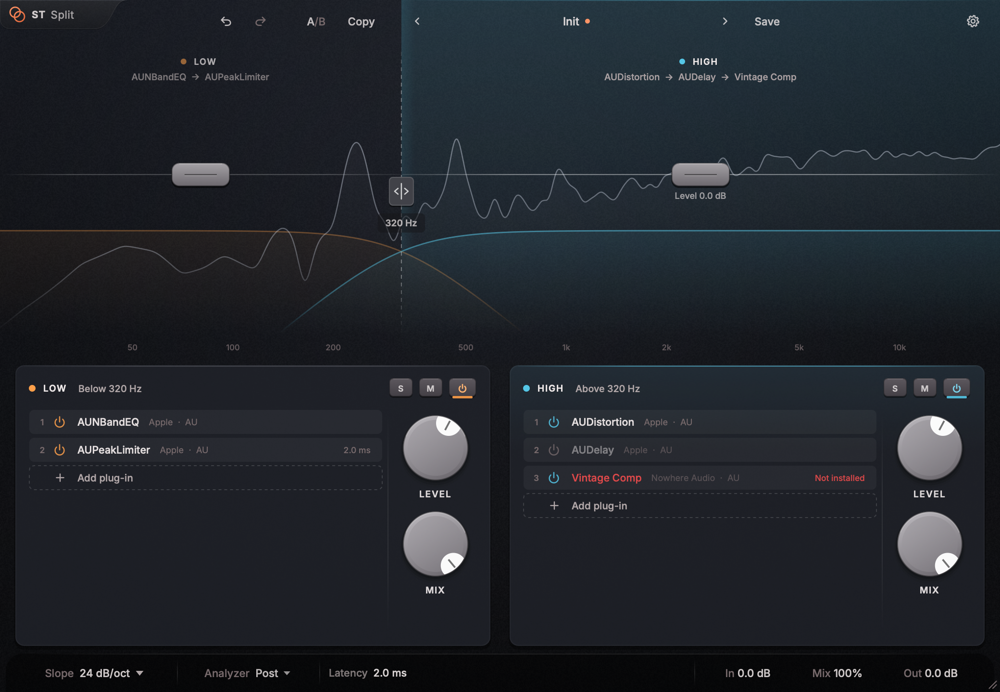

# ST Split

Split a track at any frequency and run **your own plug-ins** on each side: a compressor on everything below
400 Hz, a distortion on everything above it, any Audio Unit or VST3 you own. VST3 and AU for macOS
(Apple Silicon + Intel). Built on [st-shell](https://github.com/davidstokarski/st-shell).



## Features

- Phase-coherent Linkwitz–Riley split (12 / 24 / 48 dB/oct): with nothing loaded the bands sum back to the input
  (flat magnitude). Drag the split on the display, wheel to nudge, double-click to reset.
- Up to 8 plug-ins per band, in series. **Add** from the rack's "Add plug-in" row, by double-clicking a band on the
  display, or from the band's right-click menu. **Click** a plug-in to open its window, **drag** to reorder or to
  move it to the other band (it keeps running), power icon to bypass, right-click to replace / move / remove.
- **Latency compensated**: each band's chain latency is lined up with the other band's, so plug-ins with lookahead
  or linear phase don't smear the crossover, and the total is reported to the host. Band and global Mix are
  latency-aligned too (parallel processing without combing).
- Per band: Level (also the pill handle on the display), Mix, Solo, Mute, Bypass.
- Everything is part of the state: sessions, presets and A/B hold the whole chain with each plug-in's settings,
  and adding / moving / removing / bypassing plug-ins is undoable.
- A plug-in that isn't installed on this machine stays in its slot (marked "Not installed") with its settings
  kept, so the session reopens correctly where it is installed.
- Plug-in list: Audio Units are read from the system registry (instant, nothing is loaded); VST3s are scanned in
  the background, incrementally, and a bundle that crashes the scan is skipped next time. Format preference
  (AU / VST3 / both) and Rescan are in the gear menu. Cache: `~/Library/Application Support/ST Audio/ST Split/`.

## Build

Expects `../st-shell` next to this repo (otherwise fetched from GitHub) and JUCE 9.0.5 in `../.st-deps/JUCE-9.0.5`
(otherwise fetched). Command Line Tools are enough.

```bash
cmake -S . -B build -G Ninja -DCMAKE_BUILD_TYPE=Release
cmake --build build
```

Builds are copied to `~/Library/Audio/Plug-Ins/{VST3,Components}`. Validate the AU with `auval -v aufx Stsp StAu`.

Tests and UI snapshots:

```bash
cmake -S . -B build -DSTSPLIT_BUILD_TESTS=ON && cmake --build build
./build/tests/StSplitPluginTests_artefacts/Release/StSplitPluginTests                     # engine, hosting, state, stress
./build/tests/StSplitPluginTests_artefacts/Release/StSplitPluginTests --snapshot /tmp/snaps  # PNG renders of the UI
```

The tests host Apple's built-in Audio Units (always installed) and, when present, the ST Sat VST3.

Release (universal build → zip with the .vst3 and .component): `scripts/release.sh` (see st-shell `docs/RELEASING.md`).
